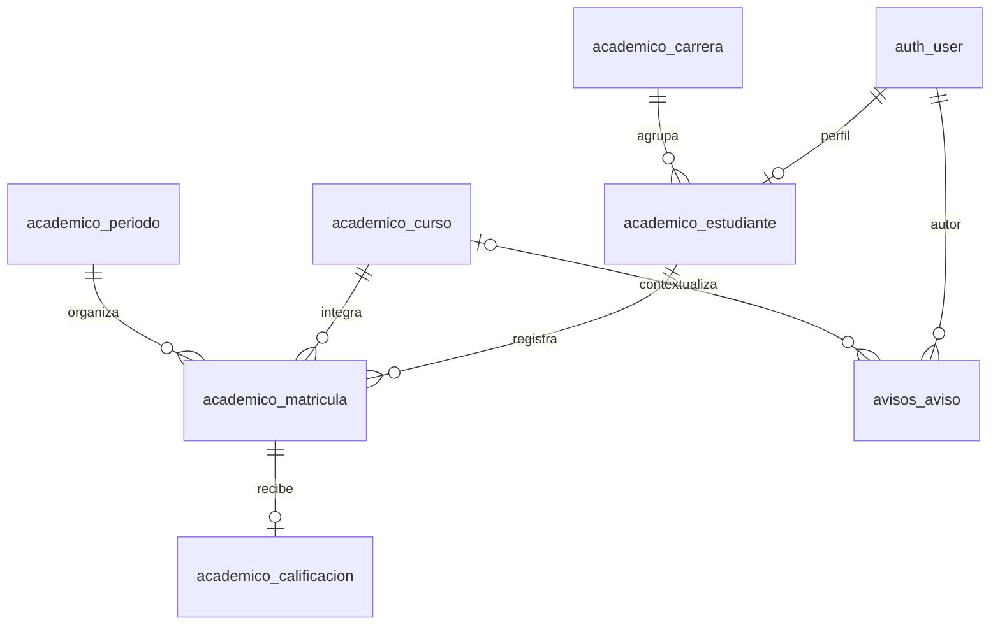

# Modelo entidad relación y diccionario

Todos los modelos propios tienen id bigint PK autogenerada. FK académicas y autor/curso de avisos usan PROTECT. Textos opcionales usan cadena vacía, no NULL; solo curso y fecha_fin de Aviso admiten NULL.

| Tabla | Campos | Reglas |
|---|---|---|
| academico_carrera | codigo varchar(20), nombre varchar(120) | codigo UNIQUE; nombre no es único por contrato |
| academico_periodo | nombre varchar(60), fecha_inicio/fecha_fin date | nombre UNIQUE; CHECK fin >= inicio |
| academico_curso | codigo varchar(20), nombre varchar(120), descripcion text opcional | codigo UNIQUE; no tiene carrera ni créditos en este contrato |
| academico_estudiante | user_id OneToOne FK, carrera_id FK, codigo varchar(20), telefono varchar(25), direccion varchar(200) | user y codigo UNIQUE; contacto opcional |
| academico_matricula | estudiante_id/curso_id/periodo_id FK, fecha_registro timestamptz | UNIQUE triple; fecha automática |
| academico_calificacion | matricula_id OneToOne FK, nota numeric(5,2), observacion varchar(250), actualizada_en timestamptz | nota CHECK 0..100; matrícula UNIQUE; actualización automática |
| avisos_aviso | autor_id FK, curso_id FK nullable, titulo varchar(150), contenido text, fecha_publicacion/fecha_fin timestamptz, publicado boolean | publicado=False; fin NULL o >= publicación; curso NULL = general |

Auth_user mantiene hash de contraseña, nombre, correo y estado; auth_group guarda Estudiante y Administrador. Roles se comprueban en servidor. El propietario de cada consulta se obtiene de request.user, nunca de un ID de usuario enviado por formulario. Las tablas privadas no se consultan desde JavaScript.

## Supabase

Las tablas se crean mediante migraciones generadas por Herson, no mediante copias manuales de CREATE TABLE. En un proyecto Supabase dedicado al portal, desactivar Data API si no se usa: también existen tablas de autenticación Django que no deben exponerse a la API pública. Usar cadena Session pooler con TLS en .env privado; no usar la clave anon como contraseña de PostgreSQL.
