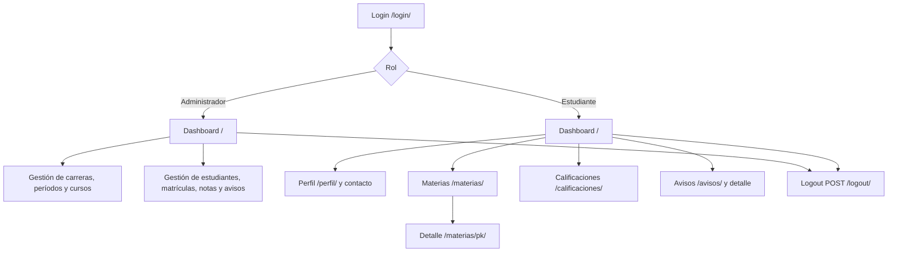

# Mapa de navegación y rutas

En 1a funcionan /login/, /logout/, / y /gestion/carreras/, /gestion/periodos/, /gestion/cursos/, con crear/, <pk>/editar/ y <pk>/eliminar/. /admin/ conserva Django Admin para los modelos. Las demás rutas pertenecen a los paquetes siguientes y no deben enlazarse hasta existir.

Nombres definitivos de consulta: dashboard, perfil, perfil_editar, mis_materias, materia_detalle, mis_calificaciones, avisos_lista, aviso_detalle. El pk del detalle de materia es de Matricula, no de Curso. Gestión: <entidad>_lista/crear/editar/eliminar.
